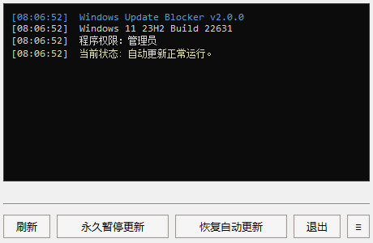
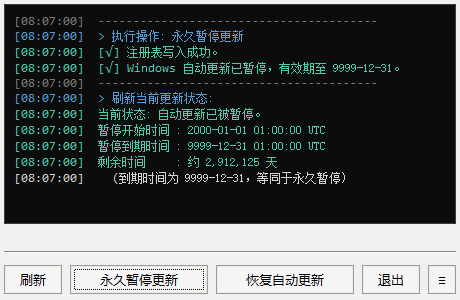

<div align="center">

<h1>Windows Update Blocker</h1>

[](#)
[](#)
[](#)
[](#)
[](LICENSE)

一键 **暂停** 或 **恢复** Windows 自动更新。

将暂停更新的时间延长至 **9999年12月31日**（意义上的永久暂停）

</div>

## 📸 截图展示

|正常状态|暂停更新状态|
| --- | --- |
|  |  |

## ✅ 优势

对于传统的工具来说，我们只针对**Windows自动更新**，不影响`Windows Update`服务，对于需要使用微软产品的用户十分友好

## 🛠️ 原理

修改以下注册表路径的键值：
`HKEY_LOCAL_MACHINE\SOFTWARE\Microsoft\WindowsUpdate\UX\Settings`

**暂停更新时写入的键值：**
* `FlightSettingsMaxPauseDays` 允许暂停更新的最大天数（DWORD `0xFFFFFFFF`）
* `PauseFeatureUpdatesStartTime` 功能更新暂停开始时间
* `PauseFeatureUpdatesEndTime` 功能更新暂停结束时间
* `PauseQualityUpdatesStartTime` 质量更新暂停开始时间（日常补丁、安全更新）
* `PauseQualityUpdatesEndTime` 质量更新暂停结束时间
* `PauseUpdatesStartTime` 所有更新暂停开始时间
* `PauseUpdatesExpiryTime` 暂停更新到期时间

**恢复更新：**
删除上述键值，即可让 Windows 恢复默认策略。

## ⬇️ 下载使用

[](https://github.com/NeetheCheeBao/WU-Blocker/releases)

## 🛠️ 本地编译

1. 克隆仓库到本地

```bash
git clone https://github.com/NeetheCheeBao/WU-Blocker.git
```

或者

```bash
gh repo clone NeetheCheeBao/WU-Blocker
```

2. 一键编译

```bat
.\build.bat
```

- 产物位置：`dist\WU-Blocker.exe`

## 📁 项目结构

```text
WU-Blocker
|   .gitignore
|   build.bat           #一键编译脚本
|   build.rs            #构建期生成图标资源、清理 Cargo.lock
|   Cargo.lock          #依赖锁定
|   Cargo.toml
|   LICENSE
|   README.md
|   version.ini         #版本号文件
|
+---assets
|       icon.ico        #图标
|
+---screenshot          #截图
|       demo1.png
|       demo2.png
|
\---src
        main.rs         #入口：DPI 感知、管理员提权、启动 GUI
        win.rs          #UTF-16 / COLORREF 转换与 Win32 常量
        config.rs       #应用名称常量 + 解析 version.ini
        core.rs         #平台层入口，挂载 core_* 子模块
        core_reg.rs     #注册表键句柄 RAII 与读写封装
        core_time.rs    #UTC 换算、ISO 解析（含 3 个测试）
        core_sys.rs     #管理员判断、系统版本描述
        core_status.rs  #Kind / LogLine 类型、更新状态查询
        core_action.rs  #暂停 / 恢复更新、打开注册表与主页
        ui.rs           #界面层入口，挂载 ui_* 子模块
        ui_theme.rs     #配色画刷、字体、DPI 缩放、内嵌图标
        ui_state.rs     #控件 ID、定时器、按钮表、AppState
        ui_layout.rs    #按 DPI 计算终端、分隔线与按钮矩形
        ui_term.rs      #RichEdit 写入、中英文分段字体
        ui_paint.rs     #底衬、边框、分隔线、自绘按钮
        ui_menu.rs      #鼠标悬停跟踪、右上角弹出菜单
        ui_window.rs    #窗口创建、消息分发、命令处理、主循环
```

## ⚖️ 许可证

本项目采用 GNU General Public License v3.0 许可证 - 详情请参阅 [LICENSE](LICENSE) 文件。
